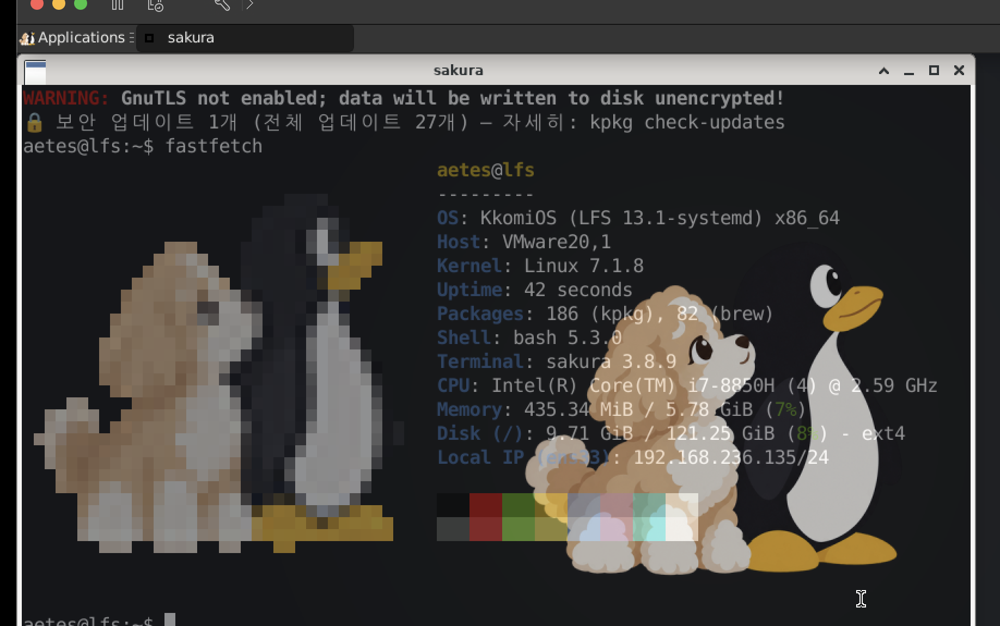
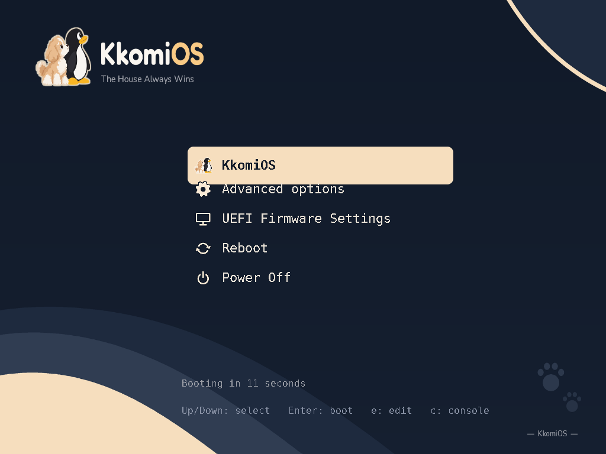
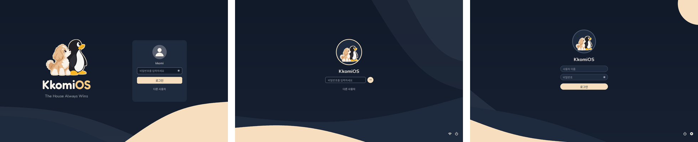
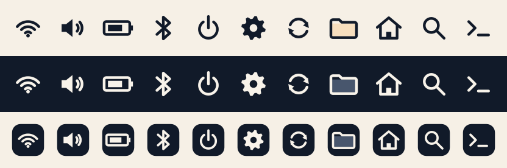

<p align="center">
  
</p>

<p align="center">
  <b>반려견 꼬미의 이름을 딴, 처음부터 직접 만든 개인 리눅스 배포판</b><br>
  <i>A personal Linux distribution built from scratch, named after my dog Kkomi.</i>
</p>

<p align="center">
  <a href="#한국어">한국어</a> · <a href="#english">English</a>
</p>

---

## 한국어

### 안녕하세요, 꼬미입니다 🐾

KkomiOS는 **Linux From Scratch(LFS)** 책을 따라 컴파일러와 C 라이브러리부터 한 단계씩 직접 빌드해서 만든 개인 리눅스입니다.
이름은 우리 집 강아지 **꼬미**에서 따왔고, 로고에는 꼬미와 리눅스 펭귄 턱스(Tux)가 함께 있습니다.

다른 배포판을 설치해서 꾸민 것이 아니라, 커널 설정부터 패키지 관리자, 부팅 화면까지 **하나씩 직접 만들고 고치면서** 리눅스가 어떻게 돌아가는지 배우는 프로젝트입니다.
그래서 아직 서툰 곳도 많고, 그 과정까지 숨기지 않고 기록하고 있습니다.

### 스크린샷

| 바탕화면과 fastfetch | GRUB 부팅 메뉴 |
|---|---|
|  |  |

**로그인 화면 테마 A · B · D** — 디자인 단계의 합성 미리보기이며, 실제 로그인 화면(LightDM)에는 아직 적용 전입니다.


**아이콘 테마 kkomios-a · b · d** (위에서부터)


### 현재 구성

| 분류 | 내용 |
|---|---|
| 기반 | LFS 13.1 (systemd판), x86_64 |
| 실행 환경 | VMware Fusion 가상 머신 (인텔 맥북 프로 2018 위) |
| 커널 | Linux 7.1.8, 직접 설정 (VM용 사운드, RAID 0/1/10/5·6, 라이브 USB용 squashfs·overlayfs, 노트북용 인텔 그래픽·와이파이·블루투스·SOF 사운드 드라이버 미리 포함) |
| 부트로더 | GRUB + KkomiOS 테마 (`branding/grub/`) |
| 시스템 | systemd, Linux-PAM, Shadow, Polkit, systemd-logind (전원·재시작 권한, 장치 권한) |
| 그래픽 | X.Org 서버 21.1.25 |
| 데스크톱 | Xfce 4.20 (위·아래 패널), tty1 자동 로그인 후 `startx` |
| 터미널 | sakura (VTE 0.84.1) |
| 한글 입력 | fcitx5 + 한글 엔진 (`Ctrl+Space` / `Shift+Space`로 전환) |
| 소리 | PipeWire 1.6.9 + WirePlumber 0.5.18 |
| 웹 브라우저 | Firefox (Mozilla 공식 배포판) |
| 글꼴 | 나눔 글꼴, Noto Color Emoji |
| 기타 | fastfetch (꼬미 컬러 로고), Python 3.14.8, OpenSSL 4.0.3, 일부 개발 도구는 Homebrew 사용 |
| 패키지 관리 | **kpkg** (직접 만든 패키지 관리자, 아래 설명) |

### kpkg — 직접 만든 패키지 관리자

LFS에는 패키지 관리자가 없어서 직접 만들었습니다. 셸 스크립트 하나(`kpkg/kpkg`, 현재 0.7)입니다.

- **레시피 → 패키지 → 설치**: 레시피(`recipes/*.sh`)대로 빌드해서 임시 폴더(DESTDIR)에 설치하고, 패키지 파일(`.kpkg.tar`)로 묶은 뒤 시스템에 반영합니다.
- **파일 기록**: 패키지마다 설치한 파일 목록을 남겨서 깔끔하게 지우고(`remove`), 어떤 파일이 어느 패키지 것인지(`owns`) 찾을 수 있습니다.
- **충돌 검사**와 **설정 파일 보호**: `/etc` 아래 설정을 직접 고쳤으면 덮어쓰지 않고 새 버전을 `.kpkgnew`로 따로 둡니다.
- **기존 시스템 등록**: 손으로 빌드한 LFS 기본 시스템을 `base`로 등록하고(`adopt-base`), LFS 책의 패키지 버전도 기록합니다(`register-lfs`).
- **업데이트·보안 점검**: `kpkg-check`가 매일 BLFS·LFS 책의 최신 버전, **LFS 보안 공지**와 비교해서 터미널을 열 때 알려 줍니다.

```
kpkg build recipes/openssl.sh                       # 패키지 만들기 (일반 사용자로)
kpkg install /var/cache/kpkg/openssl-4.0.3.kpkg.tar # 설치·업그레이드
kpkg list | info 이름 | files 이름 | owns 경로      # 조회
kpkg check-updates                                  # 업데이트·보안 점검
```

### 진행 상황

**된 것**
- LFS 기본 시스템, 커널, GRUB 부팅
- X11 + Xfce 데스크톱, 한글 입력, 소리, Firefox, 맥 ↔ VM 클립보드
- PAM·Polkit 기반 로그인 세션 (종료·재시작 버튼 정상)
- kpkg 패키지 관리자, 매일 보안 점검, 보안 업데이트 적용 (xz, pcre2, libpng, OpenSSL, util-linux, X 서버, expat, Python)
- 브랜딩: 로고, 배경화면, GRUB 테마, 로그인 화면 3종·아이콘 3종 에셋, fastfetch 로고

**아직 안 된 것 / 알려진 문제**
- **실제 컴퓨터에서는 아직 한 번도 돌려 보지 않았습니다.** 지금은 VMware 가상 머신에서만 돌아갑니다.
- **설치용 ISO와 설치 프로그램이 아직 없습니다.** 지금은 LFS 책대로 직접 빌드한 시스템 위에서만 쓸 수 있습니다.
- glib 보안 업데이트 대기 중 (GTK4 작업과 함께 진행 예정)
- sakura 실행 시 `GnuTLS not enabled` 경고 (VTE를 GnuTLS 없이 빌드함)
- 로그인 화면과 아이콘 테마는 에셋만 있고 실제 적용 전
- 노트북용 드라이버는 커널에 넣어 두었지만 실제 기기에서 확인 전

### 로드맵

1. **기반**: gobject-introspection 다시 켜기 → GTK4 → kpkg 묶음(그룹) 기능 → LightDM(로그인 테마 A·B·D 적용)
2. **데스크톱 추가**: Openbox → MATE → KDE Plasma → GNOME(Wayland). 설치할 때 원하는 것을 고를 수 있게
3. **기본 앱 묶음**: Firefox, Celluloid, NetworkManager 등 공통 앱 + 각 데스크톱의 기본 앱, LibreOffice는 선택
4. **부팅 화면**: Plymouth 테마
5. **라이브 USB(ISO)**: Xfce 체험 모드, BIOS·UEFI 둘 다 부팅
6. **설치 프로그램**: 글자 메뉴 방식 먼저, 이후 그래픽 설치 프로그램(Calamares)
7. **실제 노트북(씽크패드 E14 Gen 7)**: 와이파이, 블루투스, 전원 관리, 터치패드, 밝기·볼륨 키, 듀얼부팅
8. **바이너리 저장소**: 미리 빌드한 패키지를 내려받아 설치

### 빌드·설치 방법

아직 ISO가 없으므로, **LFS 13.1 (systemd판) 책대로 빌드한 시스템**이 있어야 합니다.

```bash
# 1. 저장소 받기
git clone https://github.com/VertigoJang/kkomios.git ~/kkomios && cd ~/kkomios

# 2. kpkg 설치
sudo install -m755 kpkg/kpkg kpkg/kpkg-check kpkg/kkomios-pkgcount /usr/local/bin/
sudo install -Dm644 kpkg/aliases /etc/kpkg/aliases

# 3. 지금 시스템을 kpkg에 등록 (처음 한 번)
kpkg adopt-base          # 지금 있는 파일 전체를 'base' 로 기록
kpkg register-lfs 13.1   # LFS 책의 패키지 버전 기록

# 4. 매일 업데이트·보안 점검 켜기 (선택)
sudo install -m644 kpkg/systemd/kpkg-check.service kpkg/systemd/kpkg-check.timer /etc/systemd/system/
sudo systemctl daemon-reload && sudo systemctl enable --now kpkg-check.timer

# 5. 레시피로 패키지 빌드·설치
kpkg build recipes/pipewire.sh
kpkg install /var/cache/kpkg/pipewire-1.6.9.kpkg.tar

# 6. GRUB 테마 (grub.cfg 를 백업한 뒤 적용)
bash branding/grub/install-grub-theme.sh

# 7. 아이콘 테마 (데스크톱 설정에서 고르기)
sudo cp -r branding/themes/icons/kkomios-* /usr/share/icons/
```

> ⚠️ 개인 학습용 프로젝트입니다. 부트로더나 시스템 라이브러리를 바꾸는 단계가 있으니, 중요한 컴퓨터에서는 쓰지 마시고 백업을 먼저 해 주세요.

### 저장소 구성

```
kpkg/              패키지 관리자 kpkg, 업데이트 점검 kpkg-check, systemd 타이머
recipes/           패키지 빌드 레시피 (_template.sh 참고)
branding/          로고, 배경화면, 글꼴, 출처(CREDITS.md)
  grub/            GRUB 테마 + 설치 스크립트
  logo/            단색 로고
  themes/          로그인 화면 3종, 아이콘 테마 3종 (themes/README.md)
docs/              README 용 배너와 스크린샷
```

### 라이선스

- **코드** (kpkg, 레시피, 스크립트): [GNU GPL v3 이상](LICENSE)
- **꼬미 캐릭터, KkomiOS 로고와 그림** (`branding/` 의 이미지, `docs/` 의 그림): [CC BY-NC 4.0](branding/LICENSE-CC-BY-NC-4.0.txt) — 출처를 밝히면 쓸 수 있지만 **상업적 이용은 금지**입니다.
- 글꼴(Fredoka, Nunito: SIL OFL 1.1 / DejaVu)과 턱스 원작자 출처는 [branding/CREDITS.md](branding/CREDITS.md) 를 따릅니다.

### 만든 사람

**장현기** ([@VertigoJang](https://github.com/VertigoJang)) — 그리고 늘 옆에 있는 꼬미 🐶

---

## English

### Hi, this is Kkomi 🐾

KkomiOS is a personal Linux system built by hand, step by step, following the **Linux From Scratch (LFS)** book — starting from the compiler and C library.
It is named after my dog **Kkomi**, and the logo shows Kkomi together with Tux, the Linux penguin.

Rather than customizing an existing distribution, this is a learning project: the kernel config, the package manager and the boot screens are all built and fixed one piece at a time. It is still rough in places, and I record that honestly.

### What's inside

- **Base**: LFS 13.1 (systemd), x86_64, currently running in a VMware Fusion VM
- **Kernel**: Linux 7.1.8 with a custom config (RAID, live-USB support, laptop drivers prepared)
- **Desktop**: X.Org 21.1.25 + Xfce 4.20, sakura terminal, fcitx5 Korean input
- **Audio**: PipeWire 1.6.9 + WirePlumber 0.5.18
- **System**: systemd, Linux-PAM, Polkit, logind
- **Apps**: Firefox, fastfetch with the Kkomi logo
- **kpkg**: a home-made package manager (recipe → DESTDIR → package → install with file tracking, conflict checks, `/etc` protection) plus `kpkg-check`, a daily update and **LFS security advisory** checker
- **Branding**: GRUB theme, three login-screen themes and three icon themes (A · B · D)

### Status

- Works in a VM only — **not yet tested on real hardware**
- **No installer ISO yet**; you need an LFS 13.1 systemd system to use this repository
- Login and icon themes are designed but not applied yet; glib security update pending

### Roadmap

GTK4 & GObject Introspection → LightDM with login themes → more desktops (Openbox, MATE, KDE Plasma, GNOME on Wayland) selectable at install → Plymouth boot splash → live USB ISO (BIOS + UEFI) → installer (text first, then Calamares) → real laptop support (ThinkPad E14 Gen 7) → binary package repository

### Build & install

See the commands in the Korean section above ([빌드·설치 방법](#빌드설치-방법)); they are the same on any LFS 13.1 systemd system.

### License

- **Code** (kpkg, recipes, scripts): [GNU GPL v3 or later](LICENSE)
- **Kkomi character, KkomiOS logo and artwork**: [CC BY-NC 4.0](branding/LICENSE-CC-BY-NC-4.0.txt) — **no commercial use**
- Fonts and Tux attribution: see [branding/CREDITS.md](branding/CREDITS.md)

### Author

**Hyeongi Jang (장현기)** — [@VertigoJang](https://github.com/VertigoJang), with Kkomi 🐶
